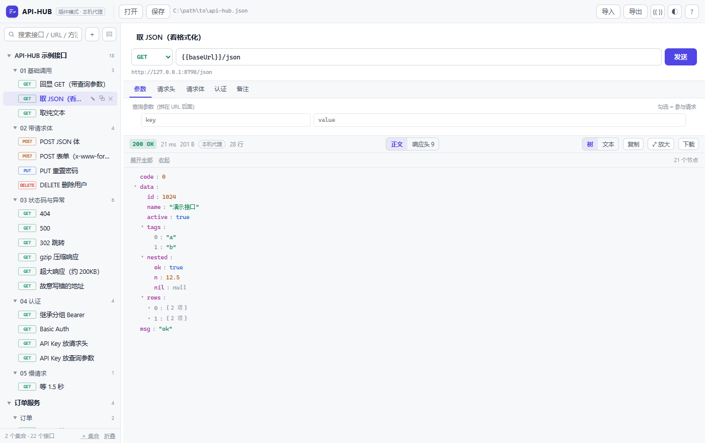

# API-HUB API console · dsh-api-hub

<div align="center">
  <a href="README.md">中文</a> · <b>English</b>
</div>

> **A Postman-style API console inside DeepSeek Harness's sidebar.**
> Import Postman collections, send a request with one click, and keep every endpoint in a single local JSON file — no cloud, no backend.

[](LICENSE)
[](https://github.com/AFAP/dsh-api-hub/releases)
[](https://github.com/deepseek-ai/deepseek-harness)

## 1. What it solves

Debugging an API usually means opening Postman or typing a long curl command: one is a heavy client, the other is a terminal full of flags. API-HUB puts import, send and inspect into the DSH sidebar, and keeps your endpoint list in a plain JSON file you can read, edit and commit.

- One page, two runtimes: installed in DSH it sends through a **local proxy** (no CORS limits); opened on its own it falls back to **direct browser requests**.
- One data file holds any number of collections.
- Nothing is uploaded anywhere; no request is made until you click Send.

## 2. Features

- ✅ **Import Postman collections**: v2.1, v2.0, v1 and environment exports; pick or drop several files, one file per collection.
- ✅ **Local-proxy requests**: the Host half uses `node:http(s)`, so browser CORS does not apply; self-signed certificates can be ignored.
- ✅ **Three response views**: JSON as a collapsible **tree** by default (big arrays paged in, huge nodes fall back to text), plus formatted raw text and a header table.
- ✅ **One JSON for all collections**: collections, folders, requests, variables and notes stay in one file you can move or save elsewhere.
- ✅ **Drag to reorder**: drag collections, or drag requests across folders and collections; touch users can use the ↑ / ↓ buttons in the edit dialog.
- ✅ **Variables**: global and collection scopes, plus `{{$timestamp}}`, `{{$isoTimestamp}}`, `{{$guid}}`, `{{$randomInt}}`.
- ✅ **Full request bodies**: `none` / `raw` (JSON, XML, HTML, text) / `x-www-form-urlencoded` / `form-data` (with files).
- ✅ **Editor ergonomics**: search, keyboard shortcuts, resizable split view, light and dark themes that follow the host.
- ✅ **Standalone fallback**: the same `web/index.html` opens by itself without DSH; browsers without the file API fall back to downloading JSON.

## 3. Preview



The left pane lists collections, folders and requests. The right top area holds the request editor (method, URL, params, headers, body, auth, note). Below it is the response: status, duration, size, who sent it, and the default JSON tree view.

## 4. Quick start

### 4.1 Install into DeepSeek Harness (recommended)

```powershell
dsh plugin --profile web add github:AFAP/dsh-api-hub
```

Then **restart `dsh web`**; a plug icon labelled "API-HUB" appears in the left sidebar.

> The plugin is installed at `$DSH_HOME\profiles\web\node_modules\dsh-api-hub`, independent of the source folder.
>
> Upgrade: `dsh plugin --profile web update dsh-api-hub`
>
> Uninstall: `dsh plugin --profile web remove dsh-api-hub`

### 4.2 Open the page on its own (fallback)

Open `web/index.html` directly, or put it on any static server:

- The page probes `/api-hub/api/status`: if it answers, the page runs in **plugin mode**, otherwise in **standalone mode**;
- In standalone mode, click Open and pick a `.json` data file; edits are written back after 1.2 s of inactivity;
- Browsers without the File System Access API (for example an `http://` non-secure context) fall back to downloading JSON on Save.

### 4.3 Check the install

1. The left sidebar shows an "API-HUB" icon that opens the console;
2. The top bar says "插件模式 · 本机代理" with the data file path next to it;
3. Click Import, pick `examples/demo-api.postman_collection.json`, select a request and click Send.

## 5. Usage

### 5.1 Import

- Import Postman collections or environment exports, or drag `.json` files onto the window (multi-select supported);
- When a collection with the same name exists, choose **create new** or **merge** (merged entries are de-duplicated by method + URL + name);
- API-HUB data files are accepted too: importing one replaces the current data.

### 5.2 Data and collections

- Collections can be collapsed, renamed, exported alone or as a whole;
- Each collection can carry its own **variables** (`baseUrl`, `token`), which override global variables;
- Both collections and requests can be dragged; dropping onto a collection moves the request into it.

### 5.3 Sending requests

| | Plugin mode | Standalone mode |
|---|---|---|
| Sender | local `node:http(s)` | browser `fetch` |
| CORS | not applicable | depends on the target server |
| Self-signed certs | can be ignored (TLS option) | rejected |
| Cookies | not sent | not sent (`credentials: omit`) |
| gzip/br/zstd | decoded by the proxy | decoded by the browser |
| GBK responses | decoded by charset, GB18030 fallback | decoded by response headers |

Each `form-data` row can be switched between text and file. The file **name** is stored in the JSON, the **content is not**: picking a file again is required on another machine (the UI marks it), and a single file is limited to 40 MB.

> **GET and HEAD have no body.** Some Postman collections attach both query params and form-data to a GET request.
> In that case the body tab shows an orange notice and a button that copies the fields into the query string.

### 5.4 Shortcuts

| Key | Action |
|---|---|
| `Ctrl + Enter` | Send the current request |
| `Ctrl + S` | Save |
| `Ctrl + N` | New request |
| `Ctrl + K` / `/` | Focus the search box |
| `↑` `↓` | Move between requests (when no input is focused) |
| `Ctrl + ,` | Help and settings |

## 6. Data file and configuration

The default data file is **`$DSH_HOME\storages\dsh-api-hub\api-hub.json`**; its folder and file are created on the first save. To change it, click the path in the top bar (or Open) and enter an absolute path — a folder alone is fine and expands to `<folder>\api-hub.json`. "Save as…" writes the current data to a new file and keeps using it.

You can also set it in the plugin config (a relative path resolves against the default folder above):

```yaml
- id: dsh-api-hub
  name: dsh-api-hub
  config:
    dataFile: 'D:\my-apis\api-hub.json'
```

The data file is a plain JSON document you can edit by hand or commit:

```json
{
  "schema": "api-hub/2",
  "name": "My APIs",
  "variables": [{ "key": "env", "value": "dev", "enabled": true }],
  "collections": [
    { "id": "c_1", "name": "Order service", "description": "", "variables": [{ "key": "baseUrl", "value": "http://127.0.0.1:8080" }] }
  ],
  "folders": [{ "id": "f_1", "collectionId": "c_1", "name": "Users", "parentId": null }],
  "requests": [{
    "id": "r_1",
    "collectionId": "c_1",
    "folderId": "f_1",
    "name": "Get user",
    "method": "GET",
    "url": "{{baseUrl}}/api/user/{{userId}}",
    "params": [{ "key": "detail", "value": "1", "enabled": true }],
    "headers": [{ "key": "Accept", "value": "application/json", "enabled": true }],
    "body": { "mode": "none", "raw": "", "language": "json", "form": [] },
    "auth": { "type": "none" },
    "note": "Log in first to get a token"
  }],
  "updatedAt": "2026-11-04T12:00:00.000Z"
}
```

`url` stores the address **without** the query string; query params live in `params` and are joined at send time. Unknown fields are ignored, missing fields get defaults, and the older `api-hub/1` format is folded into a collection instead of being dropped.

## 7. Routes and security

The Host half registers one `/api-hub` prefix route:

| Method | Path | Purpose |
|---|---|---|
| GET | `/api-hub/` | Serve the single page |
| GET | `/api-hub/api/status` | `{ mode:'dsh', dataFile, dataDir, defaultDataFile }` |
| POST | `/api-hub/api/open` | `{ path }` → `{ path, exists, data }` |
| POST | `/api-hub/api/save` | `{ path, data }` → atomic write (temp file + rename) |
| POST | `/api-hub/api/send` | `{ method, url, headers, body, multipart?, timeoutMs, tlsInsecure }` → status, headers, body, duration, size |

- POST requires `application/json`; when `Origin` is present it must be same-origin, so another web page cannot write local files;
- Save paths must be absolute and end in `.json`;
- Request bodies are capped at 96 MB, responses are cut at 8 MB, and at most 5 redirects are followed;
- `/send` decodes `gzip/deflate/br/zstd`, decodes text by `charset`, and describes binary content instead of dumping it.

## 8. Local preview and development

You can run both modes without installing DSH (plain JavaScript, no build step):

```powershell
npm run preview
```

It starts three things:

- `http://127.0.0.1:8798` — an echo target (`/echo` `/json` `/text` `/gzip` `/slow` `/status/404` `/redirect` `/big`)
- `http://127.0.0.1:8799/api-hub/` — plugin mode (a fake ctx mounts the Host half)
- `http://127.0.0.1:8799/api-hub/?mode=file` — standalone mode

The preview data file is always `.preview/api-hub.json` inside the repo (git-ignored), so your real list is untouched; set `DATA_FILE` to use another path. Edit `web/index.html` and refresh, no restart needed.

## 9. Layout

```
dsh-api-hub/
├── package.json          # bundle / client declaration, engines.dsh
├── cordis.patch.yml      # inserts the dsh-api-hub row
├── lib/
│   ├── index.js          # Host half: static page, JSON read/write, HTTP(S) proxy
│   └── client.js         # Client half: sidebar entry + center panel (iframe)
├── web/
│   └── index.html        # the single page (shared by both modes)
├── locale/
│   ├── zh.json           # Plugin Manager title and description
│   └── en.json
├── examples/             # two importable demo collections
├── scripts/preview.mjs   # local preview server + echo target
├── icon.svg              # plugin list icon
├── screenshot/           # README preview image
├── README.md
├── README.en.md
├── LICENSE
└── .gitignore
```

## 10. Known limits (intentional)

- **No cookies or sessions**: `credentials: omit` keeps CORS behaviour predictable; put a token in a header instead.
- **File contents are not stored**: form-data files keep only their names.
- **No pre-request or test scripts**: Postman `event` blocks are ignored.
- **No load testing, retries or mocks**: that is not the problem this tool solves.
- **No cloud sync**: data lives only in the JSON file you choose.

## 11. FAQ

**Q: Installed, but no sidebar entry.**  
A: Restart `dsh web` first, then confirm `dsh-api-hub` is enabled on the Plugins page.

**Q: It reports `incompatible-version`.**  
A: The plugin requires DSH `^0.2.3-alpha.2`. Upgrade DSH or install a matching plugin version.

**Q: Where is the data file?**  
A: By default `$DSH_HOME\storages\dsh-api-hub\api-hub.json`. The path in the top bar is the current file; click it to change.

**Q: "Save as" does nothing in standalone mode.**  
A: Browsers without the File System Access API (non-secure contexts) download the JSON instead; that is expected.

## 12. Security and privacy

- Data is written only to the local JSON file you choose; nothing is uploaded.
- Requests go only to the URL in the editor, and only when you send them.
- The Host half rejects cross-site POSTs (an `Origin` must be same-origin) and only writes absolute `.json` paths.
- No cookies are sent and response scripts are never executed.
- This repository contains no keys, local paths or real API data.

## 13. License

MIT © 2026 AFAP

---

> A third-party DSH plugin maintained independently; not affiliated with DeepSeek.
