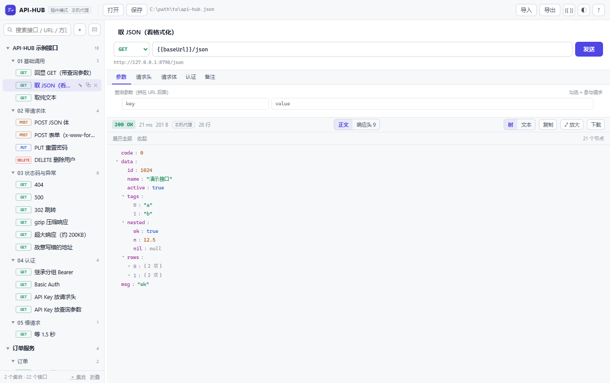

# API-HUB 接口调试台 · dsh-api-hub

<div align="center">
  <b>中文</b> · <a href="README.en.md">English</a>
</div>

> **在 DeepSeek Harness 的侧栏里开一个 Postman 风格的接口调试台。**
> 导入 Postman Collection，点一下就把请求发出去；接口清单存在本机一个 JSON 文件里，不联网、不依赖后端。

[](LICENSE)
[](https://github.com/AFAP/dsh-api-hub/releases)
[](https://github.com/deepseek-ai/deepseek-harness)

## 1. 它解决什么问题

调试接口通常要开 Postman 或者写 curl：一个是重客户端，一个是命令行里贴一长串参数。
API-HUB 把「导进来、点发送、看结果」这三件事塞进 DSH 的侧栏，接口清单还是一个人能读懂、
能进版本库的普通 JSON 文件。

- 一个页面，两种跑法：装进 DSH 走**本机代理**（没有跨域限制），单独打开走**浏览器直连**（兜底）；
- 数据只有一个文件，里面装着任意多个「集合」；
- 不发请求时不联网，不往任何服务器传东西。

## 2. 功能特性

- ✅ **导入 Postman Collection**：v2.1 / v2.0 / v1 与环境变量导出都认，一次可多选/拖入，一个文件一个集合。
- ✅ **本机代理发请求**：Host 半用 `node:http(s)` 直连，绕开浏览器跨域；可忽略自签名证书。
- ✅ **响应三视图**：JSON 默认按**树**展示（可折叠、大数组分段、节点过多自动退回文本），另有格式化原文与响应头表格。
- ✅ **一个 JSON 装所有集合**：集合、分组、接口、变量、备注全在一个文件里，可换位置、可另存为。
- ✅ **拖动排序**：集合上下拖动，接口可跨集合/分组移动；触屏可用编辑框里的「↑ 上移 / ↓ 下移」。
- ✅ **变量替换**：全局 / 集合两级作用域，支持 `{{$timestamp}}`、`{{$isoTimestamp}}`、`{{$guid}}`、`{{$randomInt}}`。
- ✅ **请求体齐全**：`none` / `raw`（JSON、XML、HTML、文本）/ `x-www-form-urlencoded` / `form-data`（含文件）。
- ✅ **IDE 手感**：搜索、快捷键、左右分栏可拖宽、浅色/深色跟随宿主主题。
- ✅ **兜底单网页**：同一份 `web/index.html` 双击就能开，不需要 DSH（浏览器不支持文件 API 时退化为「下载 JSON」）。

## 3. 效果预览



左栏是集合/分组/接口，右上是请求编辑区（方法、地址、参数、请求头、请求体、认证、备注），
下面是响应：状态码、耗时、大小、由谁发出的请求，以及默认的 JSON 树视图。

## 4. 快速开始

### 4.1 装进 DeepSeek Harness（推荐）

```powershell
dsh plugin --profile web add github:AFAP/dsh-api-hub
```

装完**重启 `dsh web`**，左侧栏出现一个插头图标的「API-HUB」，点开即可。

> 安装后插件位于 `$DSH_HOME\profiles\web\node_modules\dsh-api-hub`，与源码目录无关。
>
> 升级：`dsh plugin --profile web update dsh-api-hub`
>
> 卸载：`dsh plugin --profile web remove dsh-api-hub`

### 4.2 单独打开网页（兜底）

直接双击 `web/index.html`，或把它丢到任意静态服务器上：

- 页面探一下 `/api-hub/api/status`：探到就走**插件模式**，探不到就是**单网页模式**；
- 单网页模式下点「打开」选一个 `.json` 当数据文件，改动自动写回（1.2 秒防抖）；
- 浏览器不支持 File System Access API（比如 `http://` 非安全上下文、部分浏览器）时，「保存」退化成下载 JSON。

### 4.3 验证是否装好

1. 左侧栏出现「API-HUB」图标，点开是接口调试台；
2. 顶栏徽标显示「插件模式 · 本机代理」，右边是数据文件路径；
3. 点「导入」选 `examples/demo-api.postman_collection.json`，选一个接口点「发送」，能拿到响应。

## 5. 使用

### 5.1 导入

- 「导入」可选 Postman Collection / 环境变量导出，也可以直接把 `.json` 拖进窗口（支持多选）；
- 已有同名集合时会问**新建一个**还是**合并进去**（合并按「方法 + 地址 + 名字」去重）；
- 也认 API-HUB 自己的数据文件，导入即整个接管。

### 5.2 数据与集合

- 集合可折叠、重命名、单独导出或整包导出；
- 集合有自己的**变量**（如各自的 `baseUrl`、`token`），会盖过全局变量；
- 集合和接口都能拖动排序；拖到集合名上＝搬进那个集合。

### 5.3 发请求

| | 插件模式 | 单网页模式 |
|---|---|---|
| 谁发 | 本机 `node:http(s)` | 浏览器 `fetch` |
| 跨域 | 没有这回事 | 看目标服务放不放行 |
| 自签名证书 | 可忽略（请求设置里的 TLS 选项） | 过不去 |
| Cookie | 不带 | 不带（`credentials: omit`） |
| gzip/br/zstd | 代理解 | 浏览器自己解 |
| GBK 响应 | 按 charset 解，猜不到按 GB18030 兜底 | 按响应头解 |

`form-data` 的每一行可以切成「文本」或「文件」；文件名会存进 JSON，**文件内容不会**——
换台机器要重新选一次文件（会有「需重新选择」提示），单文件上限 40MB。

> **GET / HEAD 没有请求体。** Postman 里有些 collection 会在 GET 上同时挂查询参数和 form-data，
> 遇到这种请求，请求体页会给出橙色提示，并提供「把字段同步到查询参数」的按钮。

### 5.4 快捷键

| 键 | 作用 |
|---|---|
| `Ctrl + Enter` | 发送当前接口 |
| `Ctrl + S` | 保存 |
| `Ctrl + N` | 新建接口 |
| `Ctrl + K` / `/` | 聚焦搜索框 |
| `↑` `↓` | 在接口之间移动（鼠标不在输入框时） |
| `Ctrl + ,` | 帮助与设置 |

## 6. 数据文件与配置

默认数据文件是 **`$DSH_HOME\storages\dsh-api-hub\api-hub.json`**，第一次保存时自动创建目录与文件。
想换位置：点顶栏那条路径（或「打开」）→ 填绝对路径，只填目录也行（自动补成 `<目录>\api-hub.json`）；
「另存为…」把当前数据写到新位置并继续用新文件。

也可以在插件配置里直接指定（相对路径按上面那个默认目录解析）：

```yaml
- id: dsh-api-hub
  name: dsh-api-hub
  config:
    dataFile: 'D:\my-apis\api-hub.json'
```

数据文件就是一个普通 JSON，可以手改、可以进版本库：

```json
{
  "schema": "api-hub/2",
  "name": "我的接口",
  "variables": [{ "key": "env", "value": "dev", "enabled": true }],
  "collections": [
    { "id": "c_1", "name": "订单服务", "description": "", "variables": [{ "key": "baseUrl", "value": "http://127.0.0.1:8080" }] }
  ],
  "folders": [{ "id": "f_1", "collectionId": "c_1", "name": "用户模块", "parentId": null }],
  "requests": [{
    "id": "r_1",
    "collectionId": "c_1",
    "folderId": "f_1",
    "name": "获取用户信息",
    "method": "GET",
    "url": "{{baseUrl}}/api/user/{{userId}}",
    "params": [{ "key": "detail", "value": "1", "enabled": true }],
    "headers": [{ "key": "Accept", "value": "application/json", "enabled": true }],
    "body": { "mode": "none", "raw": "", "language": "json", "form": [] },
    "auth": { "type": "none" },
    "note": "记得先登录拿 token"
  }],
  "updatedAt": "2026-11-04T12:00:00.000Z"
}
```

`url` 只存**不带查询串**的地址，查询参数在 `params` 里，发送时再拼回去。
读到不认识的字段会忽略，缺字段会补默认值；老格式（`api-hub/1`）会自动收进一个集合，不丢东西。

## 7. 路由与安全

Host 半只注册一个 `/api-hub` 前缀路由：

| 方法 | 路径 | 说明 |
|---|---|---|
| GET | `/api-hub/` | 返回单网页 |
| GET | `/api-hub/api/status` | `{ mode:'dsh', dataFile, dataDir, defaultDataFile }` |
| POST | `/api-hub/api/open` | `{ path }` → `{ path, exists, data }` |
| POST | `/api-hub/api/save` | `{ path, data }` → 原子写入（临时文件 + rename） |
| POST | `/api-hub/api/send` | `{ method, url, headers, body, multipart?, timeoutMs, tlsInsecure }` → 状态码、响应头、响应体、耗时、大小 |

- POST 一律要求 `application/json`，带 `Origin` 时必须是同源，避免别的网页顺手写本机文件；
- 写盘路径必须是绝对路径且以 `.json` 结尾；
- 请求体上限 96MB，响应超过 8MB 截断显示，最多跟随 5 次跳转；
- `/send` 解 `gzip/deflate/br/zstd`，按 `charset` 解码，二进制内容给占位说明。

## 8. 本地预览与开发

不用装 DSH 也能把两种模式跑起来（纯 JavaScript，无构建步骤）：

```powershell
npm run preview
```

它会起三个东西：

- `http://127.0.0.1:8798` —— echo 靶子（`/echo` `/json` `/text` `/gzip` `/slow` `/status/404` `/redirect` `/big`）
- `http://127.0.0.1:8799/api-hub/` —— 插件模式（用一个假 ctx 挂上 Host 半）
- `http://127.0.0.1:8799/api-hub/?mode=file` —— 单网页模式

预览用的数据文件固定为仓库下的 `.preview/api-hub.json`（已 gitignore），不会碰你真正在用的清单；
要换路径就设环境变量 `DATA_FILE`。改完 `web/index.html` 刷新页面即可，不用重启。

## 9. 目录结构

```
dsh-api-hub/
├── package.json          # bundle / client 声明、engines.dsh
├── cordis.patch.yml      # 插入 dsh-api-hub 这一行
├── lib/
│   ├── index.js          # Host 半：静态页、读写 JSON、代发 HTTP(S) 请求
│   └── client.js         # Client 半：侧栏入口 + 中央面板（iframe）
├── web/
│   └── index.html        # 单网页本体（插件模式和兜底模式共用）
├── locale/
│   ├── zh.json           # Plugin Manager 标题与描述
│   └── en.json
├── examples/             # 两份可导入的示例集合
├── scripts/preview.mjs   # 本地预览 + echo 靶子
├── icon.svg              # 插件列表图标
├── screenshot/           # README 效果图
├── README.md
├── README.en.md
├── LICENSE
└── .gitignore
```

## 10. 已知边界（有意为之）

- **不做 Cookie / Session**：`credentials: omit`，跨域行为可预测；要登录态就往请求头里塞 token。
- **不保存文件内容**：form-data 的文件只记名字。
- **不做前置脚本 / 测试脚本**：Postman 的 `event` 一律忽略。
- **不做重复请求、压测、Mock**：这不是它要解决的问题。
- **不做云同步**：数据只在你指定的那个 JSON 文件里。

## 11. 常见问题

**Q：装了但侧栏没出现？**  
A：先重启 `dsh web`；再确认 Plugins 里 `dsh-api-hub` 已启用。

**Q：提示 `incompatible-version`？**  
A：插件要求 DSH `^0.2.3-alpha.2`，升级 DSH 或改用匹配版本的插件。

**Q：数据文件存哪了？**  
A：默认 `$DSH_HOME\storages\dsh-api-hub\api-hub.json`；顶栏那条路径就是当前文件，点它可换。

**Q：单网页模式点「另存为」没反应？**  
A：浏览器不支持 File System Access API（非安全上下文）时会退化成下载 JSON，属预期行为。

## 12. 安全与隐私

- 数据只写在你指定的本地 JSON 文件，不上传任何服务器；
- 发请求只发给地址栏里那个地址，由你触发；
- Host 半拒绝跨站 POST（带 `Origin` 时必须同源），写盘只接受绝对路径的 `.json`；
- 不带 Cookie、不在响应里执行脚本；
- 仓库本身不含任何密钥、本机路径或真实接口数据。

## 13. License

MIT © 2026 AFAP

---

> 本项目是个人维护的 DSH 第三方插件，与 DeepSeek 官方无隶属关系。
